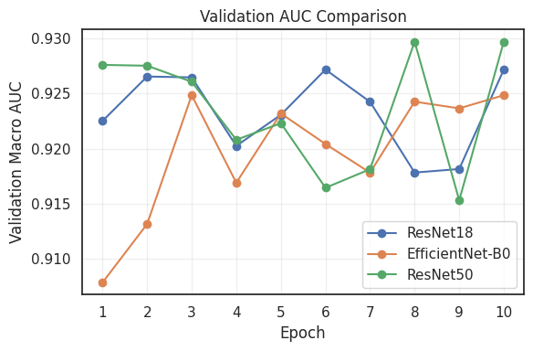
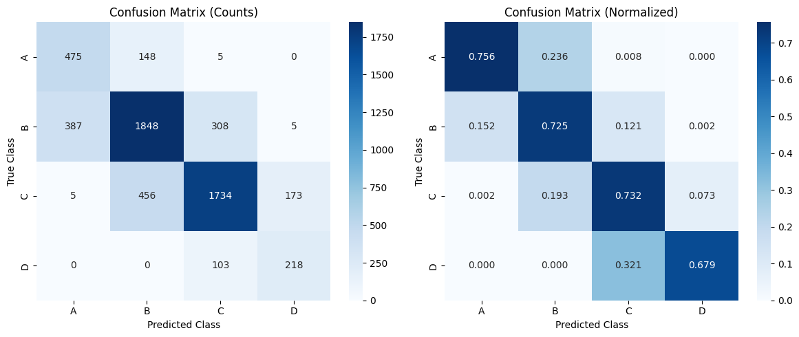
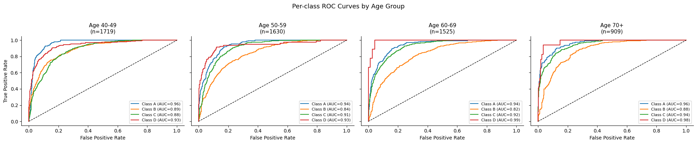
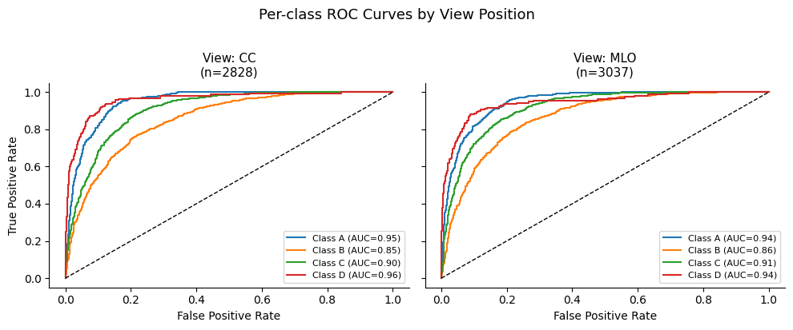
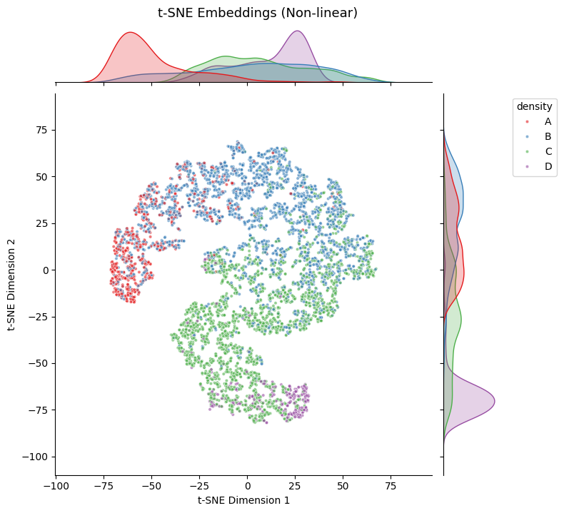
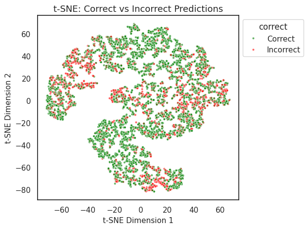

# Machine Learning For Imaging: Mammographic Density Prediction With ResNet And EfficientNet


Automatic classification of screening mammograms into the four BI-RADS breast density classes (A–D) with transfer-learning CNNs, followed by a subgroup performance analysis and an inspection of the learned feature space. Machine Learning for Imaging module, MSc Computing (Artificial Intelligence & Machine Learning), Imperial College London, 2026.

**Authors:** [Parnian Fazel](https://github.com/parnianf) and Pooja Hiremath

## Overview

Breast density is an important risk factor in breast cancer screening, and dense tissue can hide small masses. The four BI-RADS classes are A (almost entirely fatty), B (scattered fibroglandular density), C (heterogeneously dense) and D (extremely dense).

1. **Data and augmentation** – mild photometric and geometric augmentation that keeps the anatomy undistorted.
2. **Models** – ResNet-18, EfficientNet-B0 and ResNet-50, pretrained on ImageNet and fine-tuned end to end.
3. **Subgroup analysis** – performance by density class, age, view position, laterality and scanner.
4. **Model inspection** – PCA and t-SNE of the penultimate-layer embeddings, overlaid with predictions and meta information.

## Data

A preprocessed subset of the public [RSNA Screening Mammography Breast Cancer Detection](https://registry.opendata.aws/rsna-screening-mammography-breast-cancer-detection/) dataset: almost 30,000 mammograms resized to 128×96, with pre-defined training, validation and test splits (5,865 test images) and meta information (age, view position, laterality, scanner ID, density class). The images are not stored in this repository; the notebook downloads them.

## Method

- **Preprocessing:** breast segmentation (largest connected component), intensity normalisation to [0, 1], conversion to three channels and ImageNet normalisation.
- **Augmentation:** brightness (±15%) and contrast (±25%) jitter and a light Gaussian blur (kernel 3, probability 0.3); horizontal flip, rotation (±10°), translation (up to 5%) and scaling (95–105%). Vertical flips, large rotations, cropping and perspective warps are avoided to keep the images anatomically plausible.
- **Models:** the final layer of each backbone is replaced by dropout (p = 0.5) and a 4-class linear layer.
- **Training:** 10 epochs, Adam (learning rate 1e-4), batch size 256, class-balanced sampling to handle the class imbalance, seed 42. The checkpoint with the highest validation macro AUC is kept.

## Results

| Model | Parameters | Best validation macro AUC | Test macro AUC |
|---|---|---|---|
| ResNet-18 | 11.2M | 0.9272 | **0.9167** |
| EfficientNet-B0 | 4.0M | 0.9248 | 0.9147 |
| ResNet-50 | 23.5M | **0.9297** | 0.9163 |

ResNet-50 was selected on validation AUC and used for the analysis below; on the test set it reaches **72.9% accuracy** and a macro AUC of **0.916**. The three models are within 0.002 AUC of each other, so the larger network brings little: EfficientNet-B0 has about six times fewer parameters than ResNet-50 and is competitive. The small gap between validation and test AUC indicates limited overfitting.



### Where the model makes mistakes



- Errors are concentrated between adjacent density classes, which overlap visually: the most frequent are C→B (19%), B→A (15%) and B→C (12%).
- Class B is the hardest class (per-class AUC ≈ 0.86). Class D has the lowest F1-score because of its small share of the data (321 test images).

### Subgroup analysis



- **Age:** macro AUC is 0.90–0.94 in every age group from 40 upwards (highest for 70+, 0.939), with no systematic degradation. The youngest group (under 40) has only 82 test images, lacks one density class so its AUC cannot be computed, and has lower accuracy (59.8%).
- **View position and laterality:** CC and MLO views give near-identical AUC, as do left and right (0.9165 vs 0.9162), so there is no view- or side-dependent bias.
- **Scanner:** accuracy varies between machines (lowest 67.3% for machine 210, n = 214) while AUC stays high (0.91), which suggests the decision boundary shifts on some scanners rather than the model losing discriminative ability. One machine has only 26 test images and is too small to draw conclusions.



### Inspecting the embeddings



PCA and t-SNE of the ResNet-50 embeddings show classes A and D occupying distinct regions, while B and C overlap. Misclassifications sit at class boundaries, mainly in the B/C region.



Overlays by age group, view position, laterality and scanner show no structured clustering, so the model does not appear to encode demographic or acquisition attributes as dominant features. This supports the view that the errors come from genuine ambiguity between neighbouring density classes rather than from spurious correlations.

## Repository structure

```
├── mammographic_density_prediction.ipynb   # data, models, training, evaluation, subgroup and embedding analysis
├── requirements.txt
└── results/                                # figures used in this README
```

## Getting started

```bash
pip install -r requirements.txt
jupyter notebook mammographic_density_prediction.ipynb
```

- Python 3.10+ and a GPU (the experiments were run on a single NVIDIA T4).
- The notebook downloads the preprocessed dataset subset on the first run. Please follow the terms of use of the original RSNA dataset.
- Training outputs and checkpoints are written to `output/` and are not stored in the repository.

## Acknowledgements and references

- Dataset: RSNA Screening Mammography Breast Cancer Detection.
- The class-balanced sampler follows the `ImbalancedDatasetSampler` of the open-source [`torchsampler`](https://github.com/ufoym/imbalanced-dataset-sampler) package (MIT licence).
- P. Oza, P. Sharma, S. Patel, F. Adedoyin and A. Bruno, *Image augmentation techniques for mammogram analysis*, Journal of Imaging, 2022.
- K. He, X. Zhang, S. Ren and J. Sun, *Deep residual learning for image recognition*, CVPR 2016.
- M. Tan and Q. Le, *EfficientNet: Rethinking model scaling for convolutional neural networks*, ICML 2019.
